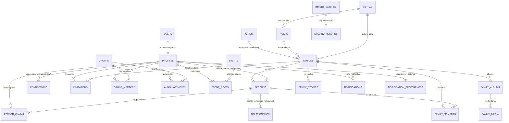

# Database Documentation — Community Roots

**Platform**: Community Roots (Community Family Census, Genealogy, Directory & Connection Platform)  
**Database**: Supabase PostgreSQL 15+  
**Target Project URL**: `https://aodbcxpzpxyatiikqeic.supabase.co`  
**Anon / Publishable API Key**: `sb_publishable_H5kEjknaIDKkd59ftR6sAw_zG8QsVPS`  

---

## Table of Contents

1. [Executive Summary & Architectural Foundations](#1-executive-summary--architectural-foundations)
2. [Database Relationship Diagram (Mermaid ER)](#2-database-relationship-diagram-mermaid-er)
3. [Domain Schemas & Detailed Table Specifications](#3-domain-schemas--detailed-table-specifications)
   - 3.1 Profiles & Identity Domain (`profiles`, `audit_logs`)
   - 3.2 Census Domain (`persons`, `gotras`, `nukhs`, `cities`)
   - 3.3 Family & Kinship Domain (`families`, `family_members`, `relationships`, `connections`)
   - 3.4 Trust & Verification Domain (`person_claims`, `invitations`, `verification_requests`, `duplicate_flags`)
   - 3.5 Community Hub Domain (`groups`, `group_members`, `announcements`, `events`, `event_rsvps`)
   - 3.6 Media & Family History Domain (`family_albums`, `family_media`, `family_stories`)
   - 3.7 Notifications & Async Domain (`notifications`, `notification_preferences`, `notification_outbox`)
   - 3.8 Ingestion & Staging Domain (`import_batches`, `staging_records`)
4. [Custom PostgreSQL Types & Enums](#4-custom-postgresql-types--enums)
5. [Database Functions, Triggers & Atomic RPCs](#5-database-functions-triggers--atomic-rpcs)
6. [Row Level Security (RLS) Policy Matrix](#6-row-level-security-rls-policy-matrix)
7. [Storage Buckets & Asset Security](#7-storage-buckets--asset-security)
8. [Migration Execution Instructions](#8-migration-execution-instructions)
9. [Supabase Dashboard Setup & Configuration Guide](#9-supabase-dashboard-setup--configuration-guide)

---

## 1. Executive Summary & Architectural Foundations

Community Roots is designed as a **modular monolith** with zero external backend microservices. Supabase PostgreSQL serves as the definitive authority for state persistence, transactional integrity, and data security.

### Core Architectural Invariants:
1. **PERSON ≠ USER Principle**:
   - `auth.users` manages authenticated credentials (email, password hash, session JWT).
   - `public.profiles` maps 1:1 with `auth.users` via foreign key `id REFERENCES auth.users(id) ON DELETE CASCADE`.
   - `public.persons` represents a human being in the historical and living census. A person record can exist without a user account (e.g. ancestors, children, offline community elders).
   - An authenticated user links to at most one person record through verified person claims or invitation onboarding.
2. **Deterministic UUID Primary Keys**:
   - All public domain tables use UUIDv4 primary keys generated by `gen_random_uuid()` (pgcrypto).
   - Prevents enumeration attacks across API boundaries.
3. **Database-Enforced Authorization (RLS)**:
   - 100% of public schema tables have Row Level Security enabled (`ENABLE ROW LEVEL SECURITY`).
   - Every CRUD operation (SELECT, INSERT, UPDATE, DELETE) is governed by explicit RLS policies or strictly blocked.
   - Frontend components never execute privileged operations directly; sensitive updates use PostgreSQL `SECURITY DEFINER` functions with rigorous internal permission guards.
4. **Audit Trail & Immutability**:
   - Sensitive mutations emit immutable logs to `public.audit_logs`.
   - `audit_logs` is append-only: updates and deletes are permanently disabled at the PostgreSQL policy level.

---

## 2. Database Relationship Diagram (Mermaid ER)



---

## 3. Domain Schemas & Detailed Table Specifications

### 3.1 Profiles & Identity Domain

#### Table: `public.profiles`
Stores application profile details for authenticated accounts.
- `id` (UUID, PK): References `auth.users(id) ON DELETE CASCADE`.
- `role` (public.user_role, NOT NULL, DEFAULT 'MEMBER'): User authorization role (`SUPER_ADMIN`, `ADMIN`, `COMMUNITY_MODERATOR`, `COMMITTEE_MEMBER`, `FAMILY_HEAD`, `MEMBER`, `GUEST`).
- `display_name` (TEXT, NOT NULL): Public or community display name.
- `linked_person_id` (UUID, NULLABLE): References `public.persons(id) ON DELETE SET NULL`.
- `status` (TEXT, NOT NULL, DEFAULT 'ACTIVE'): Account status (`ACTIVE`, `SUSPENDED`, `DEACTIVATED`).
- `email_confirmed` (BOOLEAN, NOT NULL, DEFAULT FALSE): Reflects email verification state.
- `created_at` (TIMESTAMPTZ, NOT NULL, DEFAULT NOW()): Creation timestamp.
- `updated_at` (TIMESTAMPTZ, NOT NULL, DEFAULT NOW()): Automatic trigger update timestamp.

#### Table: `public.audit_logs`
Immutable audit log for security-relevant operations.
- `id` (UUID, PK, DEFAULT gen_random_uuid()): Log unique identifier.
- `actor_id` (UUID, NULLABLE): References `auth.users(id) ON DELETE SET NULL`.
- `action` (public.audit_action, NOT NULL): Audited event type.
- `entity_type` (TEXT, NOT NULL): Target entity (`persons`, `families`, `profiles`, `roles`, etc.).
- `entity_id` (UUID, NULLABLE): Identifier of affected entity.
- `old_values` (JSONB, NULLABLE): State before modification.
- `new_values` (JSONB, NULLABLE): State after modification.
- `ip_address` (INET, NULLABLE): Client IP address.
- `created_at` (TIMESTAMPTZ, NOT NULL, DEFAULT NOW()): Timestamp of event.

---

### 3.2 Census Domain

#### Table: `public.persons`
The core community individual registry.
- `id` (UUID, PK, DEFAULT gen_random_uuid()): Person unique identifier.
- `user_id` (UUID, NULLABLE, UNIQUE): Optional reference to `auth.users(id)`.
- `first_name` (TEXT, NOT NULL): Given name.
- `middle_name` (TEXT, NULLABLE): Middle name / father's name.
- `last_name` (TEXT, NOT NULL): Surname / family name.
- `maiden_name` (TEXT, NULLABLE): Birth surname if applicable.
- `gender` (public.gender, NOT NULL): `MALE`, `FEMALE`, `OTHER`, `PREFER_NOT_TO_SAY`.
- `date_of_birth` (DATE, NULLABLE): Birth date (must be `<= CURRENT_DATE`).
- `date_of_death` (DATE, NULLABLE): Death date (must be `>= date_of_birth`).
- `is_living` (BOOLEAN, NOT NULL, DEFAULT TRUE): Vital status.
- `birth_place` (TEXT, NULLABLE): City/town of birth.
- `current_city` (TEXT, NULLABLE): Current place of residence.
- `occupation` (TEXT, NULLABLE): Professional occupation.
- `education` (TEXT, NULLABLE): Highest educational qualification.
- `phone` (TEXT, NULLABLE): Personal contact phone (governed by PII governance).
- `email` (TEXT, NULLABLE): Personal contact email (governed by PII governance).
- `avatar_url` (TEXT, NULLABLE): Controlled storage path (`avatars/persons/{id}/...`).
- `status` (public.person_status, NOT NULL, DEFAULT 'ACTIVE'): `ACTIVE`, `DRAFT`, `ARCHIVED`, `DECEASED`.
- `privacy_level` (public.privacy_level, NOT NULL, DEFAULT 'FAMILY'): Visibility boundary.
- `verification_status` (public.verification_status, NOT NULL, DEFAULT 'UNVERIFIED'): Census verification level.
- `created_by` (UUID, NULLABLE): References `auth.users(id)`.
- `created_at` (TIMESTAMPTZ, NOT NULL, DEFAULT NOW())
- `updated_at` (TIMESTAMPTZ, NOT NULL, DEFAULT NOW())
- `deleted_at` (TIMESTAMPTZ, NULLABLE): Soft-delete timestamp.

#### Table: `public.gotras`
Cultural ancestral lineage master registry.
- `id` (UUID, PK, DEFAULT gen_random_uuid())
- `name` (TEXT, NOT NULL, UNIQUE): Canonical Gotra name.
- `kuldevi` (TEXT, NULLABLE): Associated Kuldevi deity.
- `description` (TEXT, NULLABLE): Lineage notes.
- `created_at` (TIMESTAMPTZ, NOT NULL, DEFAULT NOW())

#### Table: `public.nukhs`
Sub-lineage / clan branches linked to Gotras.
- `id` (UUID, PK, DEFAULT gen_random_uuid())
- `gotra_id` (UUID, NOT NULL): References `public.gotras(id) ON DELETE CASCADE`.
- `name` (TEXT, NOT NULL): Canonical Nukh name (Unique per Gotra).
- `description` (TEXT, NULLABLE): Branch notes.
- `created_at` (TIMESTAMPTZ, NOT NULL, DEFAULT NOW())

#### Table: `public.cities`
Master directory of native locations and residential cities.
- `id` (UUID, PK, DEFAULT gen_random_uuid())
- `name` (TEXT, NOT NULL): City name.
- `state` (TEXT, NOT NULL): State / Province.
- `country` (TEXT, NOT NULL, DEFAULT 'India'): Country.
- `is_custom` (BOOLEAN, NOT NULL, DEFAULT FALSE): Indicates user-suggested record.
- `created_by` (UUID, NULLABLE): References `auth.users(id)`.
- `created_at` (TIMESTAMPTZ, NOT NULL, DEFAULT NOW())

---

### 3.3 Family & Kinship Domain

#### Table: `public.families`
The fundamental family unit record.
- `id` (UUID, PK, DEFAULT gen_random_uuid())
- `name` (TEXT, NOT NULL): Family name / Household title.
- `head_id` (UUID, NULLABLE): References `public.persons(id) ON DELETE SET NULL`.
- `gotra_id` (UUID, NULLABLE): References `public.gotras(id)`.
- `nukh_id` (UUID, NULLABLE): References `public.nukhs(id)`.
- `native_place` (TEXT, NULLABLE): Ancestral village/town.
- `current_city` (TEXT, NULLABLE): Household residence city.
- `status` (public.family_status, NOT NULL, DEFAULT 'ACTIVE'): `ACTIVE`, `DRAFT`, `ARCHIVED`.
- `privacy_level` (public.privacy_level, NOT NULL, DEFAULT 'COMMUNITY'): Family visibility tier.
- `avatar_url` (TEXT, NULLABLE): Controlled storage path (`avatars/families/{id}/...`).
- `created_by` (UUID, NULLABLE): References `auth.users(id)`.
- `created_at` (TIMESTAMPTZ, NOT NULL, DEFAULT NOW())
- `updated_at` (TIMESTAMPTZ, NOT NULL, DEFAULT NOW())
- `deleted_at` (TIMESTAMPTZ, NULLABLE): Soft-delete timestamp.

#### Table: `public.family_members`
Junction table linking individuals to families with explicit domestic roles.
- `id` (UUID, PK, DEFAULT gen_random_uuid())
- `family_id` (UUID, NOT NULL): References `public.families(id) ON DELETE CASCADE`.
- `person_id` (UUID, NOT NULL): References `public.persons(id) ON DELETE RESTRICT`.
- `role` (public.family_role, NOT NULL): `HEAD`, `SPOUSE`, `CHILD`, `PARENT`, `SIBLING`, `GRANDPARENT`, `GRANDCHILD`, `EXTENDED`.
- `is_primary` (BOOLEAN, NOT NULL, DEFAULT TRUE): Flag for member's primary household.
- `created_at` (TIMESTAMPTZ, NOT NULL, DEFAULT NOW())
- `updated_at` (TIMESTAMPTZ, NOT NULL, DEFAULT NOW())
- *Constraint*: `UNIQUE(family_id, person_id)`.

#### Table: `public.relationships`
Graph of kinship connections between two persons.
- `id` (UUID, PK, DEFAULT gen_random_uuid())
- `person_a_id` (UUID, NOT NULL): References `public.persons(id) ON DELETE CASCADE`.
- `person_b_id` (UUID, NOT NULL): References `public.persons(id) ON DELETE CASCADE`.
- `relationship_type` (public.relationship_type, NOT NULL): Kinship type (`PARENT_CHILD`, `SPOUSE`, `SIBLING`).
- `verification_status` (public.verification_status, NOT NULL, DEFAULT 'UNVERIFIED').
- `created_by` (UUID, NULLABLE): References `auth.users(id)`.
- `created_at` (TIMESTAMPTZ, NOT NULL, DEFAULT NOW())
- *Constraint*: `CHECK (person_a_id != person_b_id)`.

#### Table: `public.connections`
Social connections between community users.
- `id` (UUID, PK, DEFAULT gen_random_uuid())
- `requester_id` (UUID, NOT NULL): References `public.profiles(id) ON DELETE CASCADE`.
- `receiver_id` (UUID, NOT NULL): References `public.profiles(id) ON DELETE CASCADE`.
- `status` (public.connection_status, NOT NULL, DEFAULT 'PENDING'): `PENDING`, `ACCEPTED`, `REJECTED`, `BLOCKED`.
- `created_at` (TIMESTAMPTZ, NOT NULL, DEFAULT NOW())
- `updated_at` (TIMESTAMPTZ, NOT NULL, DEFAULT NOW())
- *Constraint*: `CHECK (requester_id != receiver_id)`, `UNIQUE(requester_id, receiver_id)`.

---

### 3.4 Trust & Verification Domain

#### Table: `public.person_claims`
Claims submitted by users asserting identity linkage to an unlinked census record.
- `id` (UUID, PK, DEFAULT gen_random_uuid())
- `person_id` (UUID, NOT NULL): References `public.persons(id) ON DELETE CASCADE`.
- `user_id` (UUID, NOT NULL): References `auth.users(id) ON DELETE CASCADE`.
- `status` (public.claim_status, NOT NULL, DEFAULT 'PENDING'): `PENDING`, `APPROVED`, `REJECTED`, `REVOKED`.
- `proof_notes` (TEXT, NULLABLE): Claimant explanation and evidence.
- `reviewed_by` (UUID, NULLABLE): References `auth.users(id)`.
- `reviewed_at` (TIMESTAMPTZ, NULLABLE)
- `created_at` (TIMESTAMPTZ, NOT NULL, DEFAULT NOW())

#### Table: `public.invitations`
Family onboarding and membership invitations.
- `id` (UUID, PK, DEFAULT gen_random_uuid())
- `token` (TEXT, NOT NULL, UNIQUE): Cryptographic random invitation token.
- `family_id` (UUID, NOT NULL): References `public.families(id) ON DELETE CASCADE`.
- `person_id` (UUID, NULLABLE): References `public.persons(id) ON DELETE SET NULL`.
- `email` (TEXT, NOT NULL): Destination invitee email.
- `invited_by` (UUID, NOT NULL): References `auth.users(id)`.
- `status` (public.invitation_status, NOT NULL, DEFAULT 'PENDING'): `PENDING`, `ACCEPTED`, `EXPIRED`, `CANCELLED`.
- `expires_at` (TIMESTAMPTZ, NOT NULL): Token expiration deadline.
- `created_at` (TIMESTAMPTZ, NOT NULL, DEFAULT NOW())

#### Table: `public.verification_requests`
Requests to verify person and family records by community moderators.
- `id` (UUID, PK, DEFAULT gen_random_uuid())
- `entity_type` (TEXT, NOT NULL): `PERSON` or `FAMILY`.
- `entity_id` (UUID, NOT NULL): ID of the record under review.
- `requester_id` (UUID, NOT NULL): References `auth.users(id)`.
- `status` (public.verification_request_status, NOT NULL, DEFAULT 'PENDING'): `PENDING`, `APPROVED`, `REJECTED`, `CANCELLED`.
- `review_notes` (TEXT, NULLABLE)
- `reviewed_by` (UUID, NULLABLE): References `auth.users(id)`.
- `created_at` (TIMESTAMPTZ, NOT NULL, DEFAULT NOW())

#### Table: `public.duplicate_flags`
Audit and resolution flags for potential duplicate census entries.
- `id` (UUID, PK, DEFAULT gen_random_uuid())
- `entity_type` (public.duplicate_entity_type, NOT NULL): `PERSON` or `FAMILY`.
- `primary_id` (UUID, NOT NULL): Existing canonical record.
- `duplicate_id` (UUID, NOT NULL): Suspected duplicate record.
- `confidence` (public.duplicate_confidence, NOT NULL): `HIGH`, `MEDIUM`, `LOW`.
- `status` (public.duplicate_flag_status, NOT NULL, DEFAULT 'OPEN'): `OPEN`, `RESOLVED_MERGED`, `RESOLVED_DISMISSED`.
- `flagged_by` (UUID, NULLABLE): References `auth.users(id)`.
- `created_at` (TIMESTAMPTZ, NOT NULL, DEFAULT NOW())

---

### 3.5 Community Hub Domain

#### Table: `public.groups`
Community sub-groups, committees, youth chapters, and regional boards.
- `id` (UUID, PK, DEFAULT gen_random_uuid())
- `name` (TEXT, NOT NULL): Group title.
- `description` (TEXT, NULLABLE): Mission and details.
- `group_type` (public.group_type, NOT NULL): `COMMITTEE`, `REGIONAL`, `YOUTH`, `SPECIAL_INTEREST`.
- `privacy_level` (public.privacy_level, NOT NULL, DEFAULT 'COMMUNITY').
- `created_by` (UUID, NOT NULL): References `auth.users(id)`.
- `created_at` (TIMESTAMPTZ, NOT NULL, DEFAULT NOW())
- `updated_at` (TIMESTAMPTZ, NOT NULL, DEFAULT NOW())

#### Table: `public.group_members`
Membership in community groups.
- `id` (UUID, PK, DEFAULT gen_random_uuid())
- `group_id` (UUID, NOT NULL): References `public.groups(id) ON DELETE CASCADE`.
- `user_id` (UUID, NOT NULL): References `public.profiles(id) ON DELETE CASCADE`.
- `role` (public.group_role, NOT NULL, DEFAULT 'MEMBER'): `ADMIN`, `MODERATOR`, `MEMBER`.
- `created_at` (TIMESTAMPTZ, NOT NULL, DEFAULT NOW())
- *Constraint*: `UNIQUE(group_id, user_id)`.

#### Table: `public.announcements`
Community broadcast bulletins and notices.
- `id` (UUID, PK, DEFAULT gen_random_uuid())
- `title` (TEXT, NOT NULL)
- `content` (TEXT, NOT NULL)
- `announcement_type` (public.announcement_type, NOT NULL): `GENERAL`, `CIRCULAR`, `URGENT`, `OBITUARY`, `MATRIMONIAL`.
- `status` (public.announcement_status, NOT NULL, DEFAULT 'PUBLISHED'): `DRAFT`, `PUBLISHED`, `ARCHIVED`.
- `target_group_id` (UUID, NULLABLE): References `public.groups(id)`.
- `created_by` (UUID, NOT NULL): References `auth.users(id)`.
- `created_at` (TIMESTAMPTZ, NOT NULL, DEFAULT NOW())
- `updated_at` (TIMESTAMPTZ, NOT NULL, DEFAULT NOW())

#### Table: `public.events`
Community events, festivals, general body meetings, and celebrations.
- `id` (UUID, PK, DEFAULT gen_random_uuid())
- `title` (TEXT, NOT NULL)
- `description` (TEXT, NULLABLE)
- `event_type` (public.event_type, NOT NULL): `FESTIVAL`, `MEETING`, `CULTURAL`, `SPORTS`, `CHARITY`.
- `location` (TEXT, NULLABLE)
- `start_date` (TIMESTAMPTZ, NOT NULL)
- `end_date` (TIMESTAMPTZ, NOT NULL)
- `status` (public.event_status, NOT NULL, DEFAULT 'UPCOMING'): `UPCOMING`, `ONGOING`, `COMPLETED`, `CANCELLED`.
- `created_by` (UUID, NOT NULL): References `auth.users(id)`.
- `created_at` (TIMESTAMPTZ, NOT NULL, DEFAULT NOW())

#### Table: `public.event_rsvps`
Attendance RSVPs for events.
- `id` (UUID, PK, DEFAULT gen_random_uuid())
- `event_id` (UUID, NOT NULL): References `public.events(id) ON DELETE CASCADE`.
- `user_id` (UUID, NOT NULL): References `auth.users(id) ON DELETE CASCADE`.
- `status` (public.event_rsvp_status, NOT NULL): `ATTENDING`, `DECLINED`, `MAYBE`.
- `guest_count` (INTEGER, NOT NULL, DEFAULT 0).
- `created_at` (TIMESTAMPTZ, NOT NULL, DEFAULT NOW())
- *Constraint*: `UNIQUE(event_id, user_id)`.

---

### 3.6 Media & Family History Domain

#### Table: `public.family_albums`
Normalized photo albums owned by families.
- `id` (UUID, PK, DEFAULT gen_random_uuid())
- `family_id` (UUID, NOT NULL): References `public.families(id) ON DELETE CASCADE`.
- `title` (TEXT, NOT NULL)
- `description` (TEXT, NULLABLE)
- `privacy_level` (public.privacy_level, NOT NULL, DEFAULT 'FAMILY').
- `created_by` (UUID, NULLABLE): References `auth.users(id)`.
- `created_at` (TIMESTAMPTZ, NOT NULL, DEFAULT NOW())
- `deleted_at` (TIMESTAMPTZ, NULLABLE)

#### Table: `public.family_media`
Media items (photographs, historical scan documents) within albums.
- `id` (UUID, PK, DEFAULT gen_random_uuid())
- `album_id` (UUID, NOT NULL): References `public.family_albums(id) ON DELETE CASCADE`.
- `storage_path` (TEXT, NOT NULL): Internal storage path in `family-media` bucket.
- `media_type` (public.family_media_type, NOT NULL): `PHOTO`, `DOCUMENT`, `HISTORICAL_RECORD`.
- `caption` (TEXT, NULLABLE)
- `file_size_bytes` (BIGINT, NOT NULL)
- `mime_type` (TEXT, NOT NULL)
- `created_by` (UUID, NULLABLE): References `auth.users(id)`.
- `created_at` (TIMESTAMPTZ, NOT NULL, DEFAULT NOW())

#### Table: `public.family_stories`
Written family oral histories and biographical narratives.
- `id` (UUID, PK, DEFAULT gen_random_uuid())
- `family_id` (UUID, NOT NULL): References `public.families(id) ON DELETE CASCADE`.
- `title` (TEXT, NOT NULL)
- `content` (TEXT, NOT NULL)
- `privacy_level` (public.privacy_level, NOT NULL, DEFAULT 'FAMILY').
- `created_by` (UUID, NULLABLE): References `auth.users(id)`.
- `created_at` (TIMESTAMPTZ, NOT NULL, DEFAULT NOW())

---

### 3.7 Notifications & Async Domain

#### Table: `public.notifications`
In-app user notifications.
- `id` (UUID, PK, DEFAULT gen_random_uuid())
- `recipient_id` (UUID, NOT NULL): References `public.profiles(id) ON DELETE CASCADE`.
- `category` (public.notification_category, NOT NULL): `ANNOUNCEMENT`, `EVENT`, `VERIFICATION`, `CLAIM`, `CONNECTION`, `FAMILY`.
- `title` (TEXT, NOT NULL)
- `body` (TEXT, NOT NULL)
- `action_url` (TEXT, NULLABLE)
- `is_read` (BOOLEAN, NOT NULL, DEFAULT FALSE)
- `created_at` (TIMESTAMPTZ, NOT NULL, DEFAULT NOW())

#### Table: `public.notification_preferences`
User notification channel preferences.
- `user_id` (UUID, PK): References `public.profiles(id) ON DELETE CASCADE`.
- `email_enabled` (BOOLEAN, NOT NULL, DEFAULT TRUE)
- `in_app_enabled` (BOOLEAN, NOT NULL, DEFAULT TRUE)
- `categories_disabled` (TEXT[], NOT NULL, DEFAULT ARRAY[]::TEXT[])

#### Table: `public.notification_outbox`
Transactional outbox queue for background email delivery via Edge Functions.
- `id` (UUID, PK, DEFAULT gen_random_uuid())
- `notification_id` (UUID, NOT NULL): References `public.notifications(id) ON DELETE CASCADE`.
- `channel` (public.notification_channel, NOT NULL): `EMAIL`.
- `status` (public.notification_delivery_status, NOT NULL, DEFAULT 'PENDING'): `PENDING`, `DISPATCHED`, `FAILED`.
- `retry_count` (INTEGER, NOT NULL, DEFAULT 0)
- `created_at` (TIMESTAMPTZ, NOT NULL, DEFAULT NOW())

---

### 3.8 Ingestion & Staging Domain

#### Table: `public.import_batches`
Administrative Excel/CSV census bulk-import batches.
- `id` (UUID, PK, DEFAULT gen_random_uuid())
- `filename` (TEXT, NOT NULL)
- `entity_type` (public.import_entity_type, NOT NULL): `PERSON`, `FAMILY`.
- `status` (public.import_batch_status, NOT NULL, DEFAULT 'UPLOADED'): `UPLOADED`, `PARSING`, `VALIDATED`, `PROMOTED`, `FAILED`, `CANCELLED`.
- `total_rows` (INTEGER, NOT NULL, DEFAULT 0)
- `valid_rows` (INTEGER, NOT NULL, DEFAULT 0)
- `invalid_rows` (INTEGER, NOT NULL, DEFAULT 0)
- `created_by` (UUID, NOT NULL): References `auth.users(id)`.
- `created_at` (TIMESTAMPTZ, NOT NULL, DEFAULT NOW())

#### Table: `public.staging_records`
Individual uncommitted staging rows during spreadsheet ingestion.
- `id` (UUID, PK, DEFAULT gen_random_uuid())
- `batch_id` (UUID, NOT NULL): References `public.import_batches(id) ON DELETE CASCADE`.
- `row_number` (INTEGER, NOT NULL)
- `raw_data` (JSONB, NOT NULL)
- `validation_status` (public.staging_validation_status, NOT NULL, DEFAULT 'PENDING'): `PENDING`, `VALID`, `INVALID`, `PROMOTED`.
- `errors` (JSONB, NULLABLE)
- `created_at` (TIMESTAMPTZ, NOT NULL, DEFAULT NOW())

---

## 4. Custom PostgreSQL Types & Enums

The database uses 30 strongly-typed PostgreSQL enums to guarantee data integrity across all states:

| Enum Name | Possible Values |
|---|---|
| `privacy_level` | `PUBLIC`, `COMMUNITY`, `FAMILY`, `PRIVATE`, `CONNECTIONS` |
| `user_role` | `SUPER_ADMIN`, `ADMIN`, `COMMUNITY_MODERATOR`, `COMMITTEE_MEMBER`, `FAMILY_HEAD`, `MEMBER`, `GUEST` |
| `gender` | `MALE`, `FEMALE`, `OTHER`, `PREFER_NOT_TO_SAY` |
| `person_status` | `DRAFT`, `ACTIVE`, `ARCHIVED`, `DECEASED` |
| `family_status` | `DRAFT`, `ACTIVE`, `ARCHIVED` |
| `family_role` | `HEAD`, `SPOUSE`, `CHILD`, `PARENT`, `SIBLING`, `GRANDPARENT`, `GRANDCHILD`, `EXTENDED` |
| `verification_status` | `UNVERIFIED`, `PENDING`, `VERIFIED`, `REJECTED` |
| `relationship_type` | `PARENT_CHILD`, `SPOUSE`, `SIBLING` |
| `connection_status` | `PENDING`, `ACCEPTED`, `REJECTED`, `BLOCKED` |
| `claim_status` | `PENDING`, `APPROVED`, `REJECTED`, `REVOKED` |
| `invitation_status` | `PENDING`, `ACCEPTED`, `EXPIRED`, `CANCELLED` |
| `verification_request_status` | `PENDING`, `APPROVED`, `REJECTED`, `CANCELLED` |
| `duplicate_entity_type` | `PERSON`, `FAMILY` |
| `duplicate_confidence` | `HIGH`, `MEDIUM`, `LOW` |
| `duplicate_flag_status` | `OPEN`, `RESOLVED_MERGED`, `RESOLVED_DISMISSED` |
| `group_type` | `COMMITTEE`, `REGIONAL`, `YOUTH`, `SPECIAL_INTEREST` |
| `group_role` | `ADMIN`, `MODERATOR`, `MEMBER` |
| `announcement_type` | `GENERAL`, `CIRCULAR`, `URGENT`, `OBITUARY`, `MATRIMONIAL` |
| `announcement_status` | `DRAFT`, `PUBLISHED`, `ARCHIVED` |
| `event_type` | `FESTIVAL`, `MEETING`, `CULTURAL`, `SPORTS`, `CHARITY` |
| `event_status` | `UPCOMING`, `ONGOING`, `COMPLETED`, `CANCELLED` |
| `event_rsvp_status` | `ATTENDING`, `DECLINED`, `MAYBE` |
| `family_media_type` | `PHOTO`, `DOCUMENT`, `HISTORICAL_RECORD` |
| `notification_category` | `ANNOUNCEMENT`, `EVENT`, `VERIFICATION`, `CLAIM`, `CONNECTION`, `FAMILY` |
| `notification_channel` | `EMAIL`, `IN_APP` |
| `notification_delivery_status` | `PENDING`, `DISPATCHED`, `FAILED` |
| `import_entity_type` | `PERSON`, `FAMILY` |
| `import_batch_status` | `UPLOADED`, `PARSING`, `VALIDATED`, `PROMOTED`, `FAILED`, `CANCELLED` |
| `staging_validation_status` | `PENDING`, `VALID`, `INVALID`, `PROMOTED` |
| `audit_action` | `INSERT`, `UPDATE`, `DELETE`, `ROLE_CHANGE`, `CLAIM_APPROVAL`, `STATUS_CHANGE` |

---

## 5. Database Functions, Triggers & Atomic RPCs

### 5.1 Authorization Helpers
- `public.is_admin()`: Returns `true` if caller is `ADMIN` or `SUPER_ADMIN`.
- `public.is_community_moderator()`: Returns `true` if caller has moderation privileges.
- `public.get_my_role()`: Returns current user's role from `public.profiles`.

### 5.2 Atomic Business Functions (RPCs)
- `public.create_family_with_head(...)`:
  - Atomically creates a family record, associates Gotra and Nukh, creates or assigns the family head, and creates the primary `family_members` record in a single database transaction.
- `public.get_person_protected_details(person_id UUID)`:
  - Securely checks authorization boundaries before revealing sensitive personal data (phone, email, residential address) to prevent unauthorized PII leakage.
- `public.accept_invitation(token TEXT)`:
  - Validates cryptographic token, binds new user to the specified family and person record, and marks invitation as accepted.
- `public.claim_notification_outbox_batch(batch_size INT)`:
  - Locks and claims unhandled email notifications for reliable edge dispatch.

### 5.3 Automated Triggers
- `handle_updated_at`: Automatically stamps `updated_at = NOW()` on row updates.
- `handle_new_user`: Automatically provisions a matching row in `public.profiles` whenever an identity is registered in `auth.users`.
- `handle_user_email_confirmed`: Synchronizes `email_confirmed` flag when a user verifies their email.
- `guard_gotra_master_integrity` & `guard_nukh_master_integrity`: Guards against invalid deletions or orphan lineages in cultural registries.

---

## 6. Row Level Security (RLS) Policy Matrix

RLS is enabled on **100% of tables**. Below is the authorization matrix:

| Table | SELECT Policy | INSERT Policy | UPDATE Policy | DELETE Policy |
|---|---|---|---|---|
| `profiles` | Own profile, or verified member for community directory | Trigger only (`handle_new_user`) | Own profile (role escalation blocked) | Admin only |
| `persons` | Public if `PUBLIC`; Verified member if `COMMUNITY`; Family member if `FAMILY`; Self/Owner if `PRIVATE` | Authenticated users | Creator, linked user, or Admin | Soft-delete only (`deleted_at`); SQL DELETE denied |
| `families` | Public if `PUBLIC`; Verified member if `COMMUNITY`; Member if `FAMILY`; Head/Creator if `PRIVATE` | Authenticated users | Family Head, Creator, or Admin | Soft-delete only (`deleted_at`); SQL DELETE denied |
| `family_members` | Visible to family members or verified members (privacy-governed) | Family Head, Creator, or Admin | Family Head, Creator, or Admin | Family Head or Admin |
| `relationships` | Visible to related persons or community members | Authenticated users | Record creator or Admin | Record creator or Admin |
| `connections` | Requester or Receiver | Authenticated (requester = auth.uid()) | Receiver or Requester | Requester or Receiver |
| `audit_logs` | Admin / Auditor only | Trigger & SECURITY DEFINER RPCs | DENIED (Immutable) | DENIED (Immutable) |
| `notifications` | Recipient only (`recipient_id = auth.uid()`) | Internal RPCs / Triggers | Recipient only (mark as read) | Recipient only |
| `groups` | Visible based on group privacy level | Authenticated users | Group Admins or System Admin | Group Admins or System Admin |
| `announcements` | Published announcements visible to target groups | Admin or Committee Author | Author or Admin | Admin only |
| `events` | Upcoming / Active events visible to members | Admin or Event Coordinator | Organizer or Admin | Admin only |

---

## 7. Storage Buckets & Asset Security

Two private storage buckets are provisioned directly in database migrations:

1. **`avatars` Bucket**:
   - **Privacy**: Private (`public = FALSE`). Direct enumeration disabled.
   - **Size Limit**: 5 MB.
   - **Allowed MIME**: `image/jpeg`, `image/png`, `image/webp`, `image/gif`.
   - **Path Pattern**:
     - `avatars/profiles/{user_id}/avatar_{timestamp}.{ext}`
     - `avatars/persons/{person_id}/avatar_{timestamp}.{ext}`
     - `avatars/families/{family_id}/avatar_{timestamp}.{ext}`
   - **Security**: Upload allowed only by owner or family head. Read governed by profile/person privacy tiers.

2. **`family-media` Bucket**:
   - **Privacy**: Private (`public = FALSE`).
   - **Size Limit**: 20 MB.
   - **Allowed MIME**: `image/jpeg`, `image/png`, `image/webp`, `image/gif`, `application/pdf`.
   - **Path Pattern**: `family-media/families/{family_id}/albums/{album_id}/{media_id}.{ext}`.
   - **Security**: Read access requires family membership or explicit album community grant.

---

## 8. Migration Execution Instructions

### Option A: 1-Click Consolidated Execution (Recommended)
All 28 sequential migration files have been compiled into a single ordered SQL script:
> **File location**: [`supabase/full_schema.sql`](file:///d:/project/PRINCIPAL_SIR/community-family-platform-main/supabase/full_schema.sql)

1. Open your Supabase Dashboard: [https://supabase.com/dashboard/project/aodbcxpzpxyatiikqeic](https://supabase.com/dashboard/project/aodbcxpzpxyatiikqeic)
2. In the left navigation, click on **SQL Editor**.
3. Click **New Query**.
4. Open `supabase/full_schema.sql`, copy all contents (`Ctrl+A`, `Ctrl+C`).
5. Paste into the Supabase SQL Editor and click **Run** (`Ctrl+Enter`).
6. The entire database schema (extensions, enums, tables, constraints, indexes, triggers, storage buckets, RLS policies, and seed data) will be executed transactionally.

### Option B: Supabase CLI
If using the Supabase CLI locally:
```bash
npx supabase link --project-ref aodbcxpzpxyatiikqeic
npx supabase db push
```

---

## 9. Supabase Dashboard Setup & Configuration Guide

After running the SQL migration, configure these settings in the Supabase Dashboard:

### 1. Authentication Settings
- Navigate to **Authentication** -> **URL Configuration**:
  - **Site URL**: `http://localhost:5173` (or your production domain).
  - **Redirect URLs**: Add `http://localhost:5173/**` and `http://localhost:5173/auth/callback`.
- Navigate to **Authentication** -> **Providers** -> **Email**:
  - For local development, you may toggle **Confirm email** OFF if you want immediate logins without email verification links.
  - For production, keep **Confirm email** ON.

### 2. Storage Buckets Verification
- Navigate to **Storage** -> **Buckets**:
  - Confirm that `avatars` and `family-media` appear in the list.
  - Note: Both buckets are marked **Private** by design. Public enumeration is disabled to protect family privacy.
