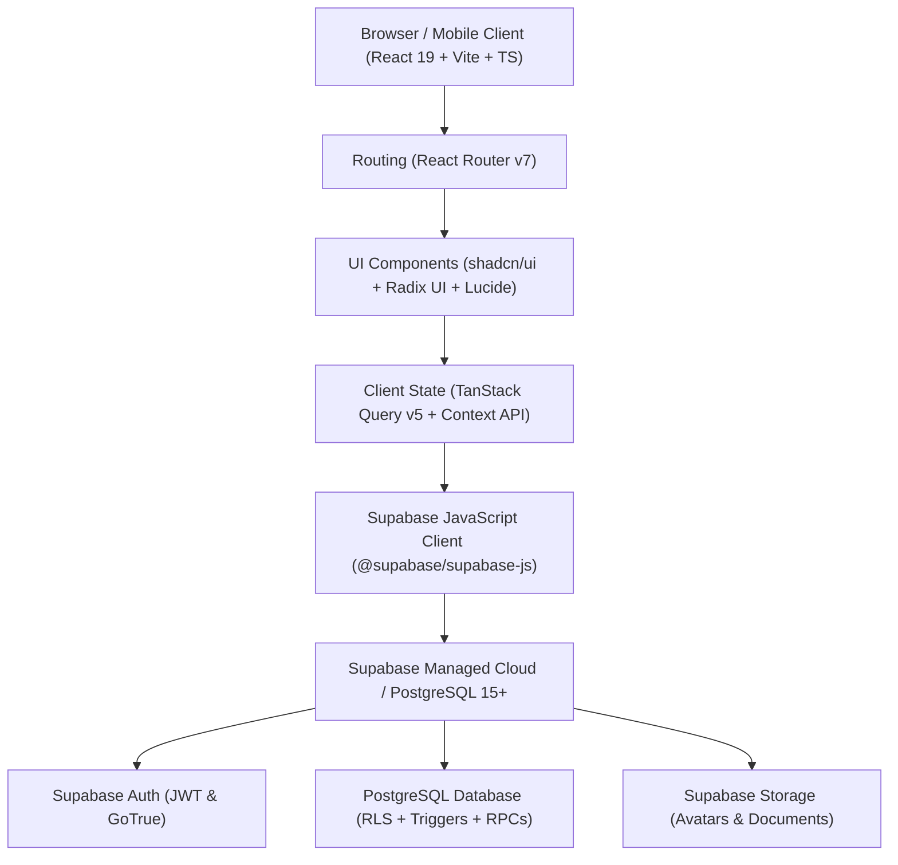
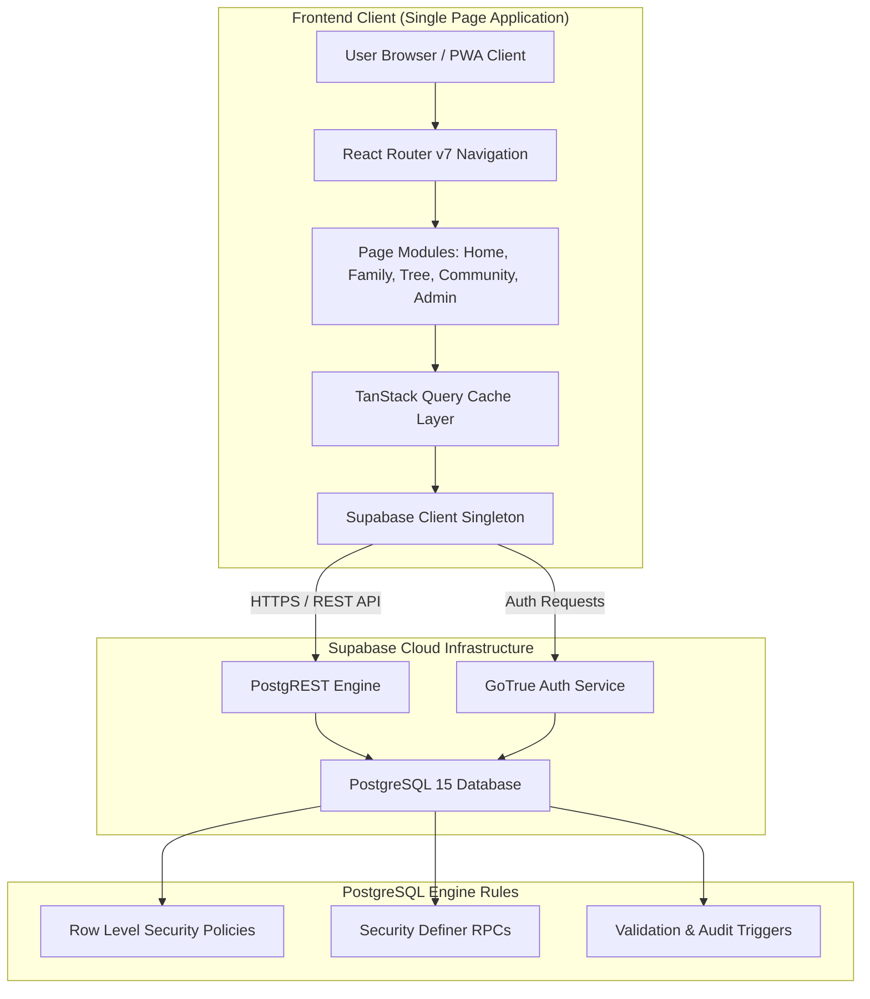
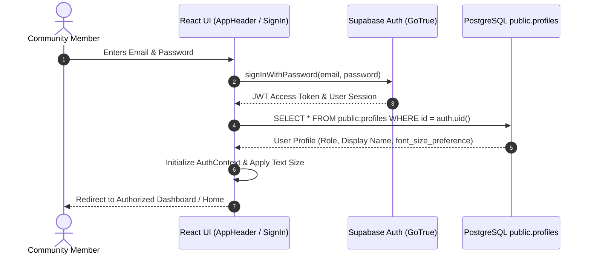
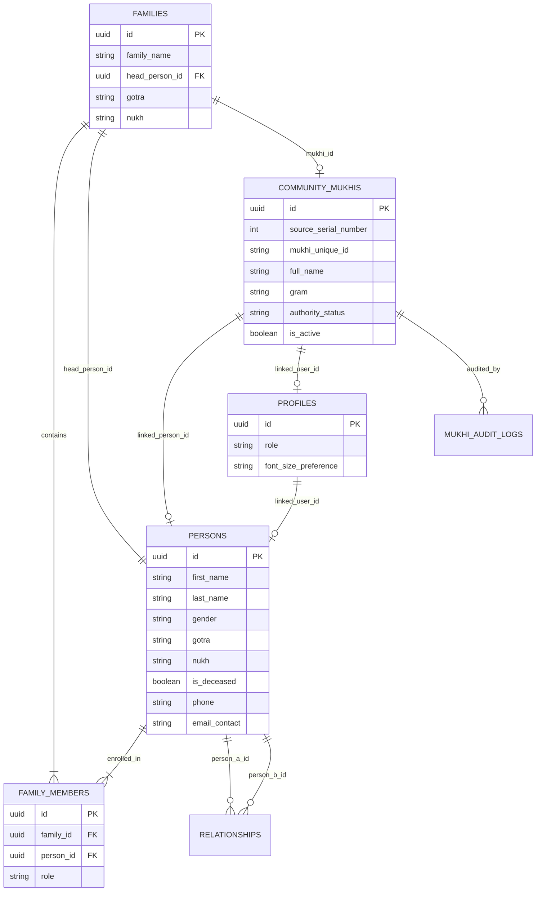

# KHATRI SARVANIYAT — COMPLETE PROJECT TECHNICAL & FUNCTIONAL DOCUMENTATION

> **Document Type:** Official System Architecture, Technical Specification & Functional Audit  
> **Project Name:** KHATRI SARVANIYAT (Community Roots Platform)  
> **Platform Version:** 0.1.0 (Production-Ready Release Candidate)  
> **Architecture Pattern:** Modular Monolith (Vite + React 19 + TypeScript + Supabase BaaS + PostgreSQL 15+ RLS)  
> **Target Community:** Shri Khatri Sarvaniyat Samaj (Worldwide Community Census & Genealogical Network)  
> **Documentation Date:** November 2026  
> **Repository Root:** `d:\project\PRINCIPAL_SIR\community-family-platform-main`  
> **Compliance & Quality Gates:** Strict TypeScript (`tsc --noEmit`: 0 errors), ESLint (0 errors, 0 warnings), Vitest (Automated Unit & Parity Suites Passing)

---

## TABLE OF CONTENTS

1. [Cover and Project Information](#1-cover-and-project-information)
2. [Executive Summary](#2-executive-summary)
3. [Project Objectives](#3-project-objectives)
4. [Project Scope](#4-project-scope)
5. [Complete Technology Stack](#5-complete-technology-stack)
6. [Overall System Architecture](#6-overall-system-architecture)
7. [Application Architecture Diagrams](#7-application-architecture-diagrams)
8. [Complete User Workflows](#8-complete-user-workflows)
9. [Authentication and Authorization](#9-authentication-and-authorization)
10. [Role-Based Access Control (RBAC)](#10-role-based-access-control-rbac)
11. [Frontend Architecture](#11-frontend-architecture)
12. [Frontend Modules and Pages Inventory](#12-frontend-modules-and-pages-inventory)
13. [Backend Architecture](#13-backend-architecture)
14. [Backend Services and API Layer](#14-backend-services-and-api-layer)
15. [Supabase Integration](#15-supabase-integration)
16. [Complete Database Schema (Data Dictionary)](#16-complete-database-schema-data-dictionary)
17. [Database Relationships & Entity-Relationship (ER) Diagram](#17-database-relationships--entity-relationship-er-diagram)
18. [Family Management Workflow](#18-family-management-workflow)
19. [Family Relationship System (13-Category Kinship Catalog)](#19-family-relationship-system-13-category-kinship-catalog)
20. [Family Tree Architecture and Visualization Logic](#20-family-tree-architecture-and-visualization-logic)
21. [Family Census and Community Directory](#21-family-census-and-community-directory)
22. [Community Mukhi Management](#22-community-mukhi-management)
23. [Executive Committee Management](#23-executive-committee-management)
24. [Other Website Modules (Panchang, Circulars, Events, Groups, Notifications)](#24-other-website-modules)
25. [Security Architecture and Row-Level Security (RLS)](#25-security-architecture-and-row-level-security-rls)
26. [Progressive Web App (PWA) Implementation](#26-progressive-web-app-pwa-implementation)
27. [AI and External Integrations Audit](#27-ai-and-external-integrations-audit)
28. [UI/UX Design System and Styling Tokens](#28-uiux-design-system-and-styling-tokens)
29. [Testing and Quality Assurance](#29-testing-and-quality-assurance)
30. [Project Setup and Installation Guide](#30-project-setup-and-installation-guide)
31. [Environment Configuration Reference](#31-environment-configuration-reference)
32. [Deployment and Production Status](#32-deployment-and-production-status)
33. [Development History and Implemented Improvements](#33-development-history-and-implemented-improvements)
34. [Current Implementation Status & Gap Analysis](#34-current-implementation-status--gap-analysis)
35. [Known Issues and Limitations](#35-known-issues-and-limitations)
36. [Technical Debt and Architectural Notes](#36-technical-debt-and-architectural-notes)
37. [Future Recommendations & Roadmap](#37-future-recommendations--roadmap)
38. [Domain Glossary](#38-domain-glossary)
39. [Complete Folder Structure](#39-complete-folder-structure)
40. [Appendix: Critical Functions, RPC Signatures, Tables & CLI Commands](#40-appendix-critical-functions-rpc-signatures-tables--cli-commands)

---

## 1. COVER AND PROJECT INFORMATION

- **Official Name:** **KHATRI SARVANIYAT**
- **Platform Classification:** Digital Community Census, Kinship Graph Engine & Heritage Archive
- **Sponsoring Body:** Shri Khatri Sarvaniyat Samaj Central Organization
- **Motto / Tagline:** *Ek Samaj • Ek Pehchaan • Ek Digital Record* ("One Community • One Identity • One Digital Record")
- **Implementation Paradigm:** Modular Monolith leveraging React 19, TypeScript, Tailwind CSS, and Supabase (PostgreSQL 15+).
- **Core Security Doctrine:** Absolute separation of presentation and authorization. The frontend manages user experience and client validation; authorization, data integrity, and privacy redaction are enforced exclusively at the database layer via PostgreSQL Row-Level Security (RLS), triggers, and security definer functions.
- **Zero Client Trust:** All sensitive mutations occur within atomic database transactions or PostgreSQL RPCs. Direct untrusted writes to sensitive authorization flags are strictly blocked.

---

## 2. EXECUTIVE SUMMARY

Historically, the genealogical records, census books, elder leadership lists, and cultural decrees of the close-knit Khatri Sarvaniyat community were maintained across paper ledgers, printed booklets, and disconnected family files.

**KHATRI SARVANIYAT** replaces this fragmentation with a cloud-native platform featuring:

1. **Strict Entity Separation (`PERSON ≠ USER`):** A human being in the community census (`public.persons`) exists independently of whether they have a login account (`auth.users`). Ancestors, children, and non-registered community members are safely cataloged, while living members can claim their profiles through administrative verification.
2. **Standardized 13-Category Kinship Catalog:** 162+ standardized family relationships with dual English and Hindi nomenclature, mathematical reciprocity, directionality, and automatic relationship derivation.
3. **Role-Independent Generational Family Tree:** Built on React Flow, the visual tree algorithm dynamically lays out generations, couples, and sibling branches based purely on biological and marital relationships—ensuring that changing administrative roles (such as Head of Family) never distorts lineage graphs.
4. **Authoritative 118-Member Mukhi Council:** Reconciled 1-to-1 against the official Samaj historical directory with full lifecycle governance (activation, claim matching, removal, and reactivation) with real-time directory synchronization.
5. **Privacy-by-Design Architecture:** A 5-tier privacy model (`PRIVATE`, `FAMILY`, `CONNECTIONS`, `COMMUNITY`, `PUBLIC`) implemented at the PostgreSQL query level to safeguard personal and contact details.

---

## 3. PROJECT OBJECTIVES

1. **Genealogical Record Preservation:** Establish a permanent digital ledger of families, Gotras, Nukhs, and generational connections.
2. **Standardized Relationship Taxonomy:** Eliminate kinship ambiguity by providing formal English terms alongside exact Hindi equivalents (e.g. `Maternal Uncle (मामा)`, `Paternal Aunt (बुआ)`).
3. **Verified Administrative Council:** Empower regional Mukhis and Central Committee members to oversee records, arbitrate claims, and publish official notices.
4. **Data Sovereignty & Privacy:** Ensure members retain control over their personal data with granular privacy levels preventing unauthorized disclosure.
5. **Accessible Community Hub:** Provide an installable, high-performance Progressive Web Application (PWA) with multi-level text accessibility scaling and responsive support across mobile, tablet, and desktop viewports.

---

## 4. PROJECT SCOPE

### Included & Implemented Capabilities
- **Authentication & RBAC:** Email/password login, registration, password recovery, session handling, and 5-tier role enforcement (`SUPER_ADMIN`, `ADMIN`, `COMMUNITY_MODERATOR`, `MUKHI`, `MEMBER`).
- **Census Registry:** Comprehensive human registry with 10 mandatory cultural fields, including Gotra, Nukh, Blood Group, Birth Place, and Deceased status.
- **Family Creation & Roster Management:** Multi-member family registration wizard with automated Head of Family linkage and shared contact inheritance.
- **Family Tree Engine:** Interactive graph canvas featuring auto-generational leveling, couple nodes `(∞)`, child branches, and key relationship panels.
- **Mukhi Governance System:** 118-seat regional council registry, profile claiming, removal/deactivation workflows, audit logging, and responsive details modal.
- **30 Standardized Occupation Categories:** Official occupation master taxonomy with bilingual labels and subcategories.
- **Executive Committee Roster:** 31-member Samaj Executive Committee directory with portfolio designations.
- **Community Modules:** Panchang cultural calendar, A4-printable Panchayat Circulars, community announcements, and events.
- **Accessibility System:** 5-step text size slider (88% to 150%) with live rem-based scaling and persistent preference storage.

---

## 5. COMPLETE TECHNOLOGY STACK



### Detailed Component Inventory

| Layer | Technology | Version | Purpose in KHATRI SARVANIYAT |
|---|---|---|---|
| **Frontend Framework** | React | `^19.2.8` | Component rendering, hooks, concurrent UI mode |
| **Build Tooling** | Vite | `^8.3.0` | Fast HMR dev server and optimized production bundling |
| **Language** | TypeScript | `~6.0.2` | End-to-end type safety, strict null checking, generated DB types |
| **Styling** | Tailwind CSS | `^3.4.17` | Utility-first CSS, CSS variables, zero-gradient color palette |
| **UI Primitives** | Radix UI / shadcn | Latest | Accessible dialogs, dropdowns, popovers, tabs, and alerts |
| **Client Routing** | React Router DOM | `^7.1.1` | Client-side routing, protected routes, navigation guards |
| **Data Fetching & Cache** | TanStack Query | `^5.62.8` | Server state management, caching, background invalidation |
| **Form Management** | React Hook Form | `^7.54.2` | Performant form state handling with minimal re-renders |
| **Schema Validation** | Zod | `^3.24.1` | Schema definition, input sanitization, form validation |
| **Tree Visualization** | React Flow | `^11.11.4` | Interactive genealogical tree canvas, custom nodes and edges |
| **Icons** | Lucide React | `^0.468.0` | Clean, accessible vector icons for all user interfaces |
| **Database & Auth** | Supabase / PostgreSQL | `15+` | Managed relational database, RLS policies, Auth engine |
| **Unit Testing** | Vitest | `^2.1.8` | Blazing fast unit and integration test runner |
| **DOM Testing** | Testing Library | `^16.1.0` | User-centric component testing and accessibility assertions |

---

## 6. OVERALL SYSTEM ARCHITECTURE

The application is structured as a **Modular Monolith**:
1. **Presentation Layer:** All UI, routing, and client forms live in a single Vite/React application.
2. **Data Access & State Layer:** TanStack Query interfaces with a single Supabase client instance. No ad-hoc `useEffect` data fetching is permitted.
3. **Database & Authorization Layer:** PostgreSQL acts as the single source of truth for business logic. Authorization, data integrity, and privacy constraints are enforced via RLS and Security Definer functions.

---

## 7. APPLICATION ARCHITECTURE DIAGRAMS

### A. Overall System Architecture



### B. Authentication & Session Architecture



---

## 8. COMPLETE USER WORKFLOWS

### A. User Registration & Profile Initialization
1. **User Action:** The user visits `/auth/sign-up` and enters Full Name, Email, Password, and Mobile Number.
2. **Frontend Validation:** Zod schema validates password complexity (minimum 8 characters with digits and symbols) and email formatting.
3. **Backend Processing:** Supabase Auth registers the user in `auth.users`.
4. **Database Trigger:** A PostgreSQL trigger `public.handle_new_user()` fires automatically, creating a corresponding row in `public.profiles` with `role = 'MEMBER'`.

### B. Family Creation Wizard
1. **Starting Point:** User navigates to `/families/new`.
2. **Step 1: Family Basics:** Enters Family Name (e.g. "VYAS FAMILY"), Gotra, Nukh, Native Place, and Current Residence.
3. **Step 2: Head of Family Details:** Enters complete profile of the Family Head (First Name, Middle Name, Last Name, Blood Group, Birth Place, Date of Birth, Email, Mobile).
4. **Step 3: Initial Members:** Adds initial family members with defined relationships to the Head.
5. **Atomic Submission:** The frontend calls `public.register_complete_family()` RPC. In a single transaction:
   - The Head `public.persons` record is inserted.
   - The `public.families` record is created linking `head_person_id`.
   - `public.family_members` records are created for all members.
   - Initial bilateral `public.relationships` are established.

### C. Add Family Member Workflow
1. User clicks **"Add Member"** in Family Detail view.
2. Modal opens with **Identity**, **Contact**, **Demographics**, and **Relationship** sections.
3. **Deceased Status Toggle:** Replaced old date-of-death requirement with a simple toggle (`is_deceased`).
4. **Email Prefill:** The Family Head's email address is automatically prefilled as default to prevent manual typing for dependent family members while allowing custom overrides.
5. **Reference Person Selection:** User selects who the new member is related to within the family.
6. **Relationship Selection:** Selects kinship term from the standardized 13-category dropdown.
7. **Atomic Persistence:** Calls `public.save_member_structured_relationship()` RPC to calculate reciprocal connections and update the family graph.

---

## 9. AUTHENTICATION AND AUTHORIZATION

### Strict Separation: `PERSON ≠ USER`
- **User (`auth.users`):** Authentication credential permitting system login.
- **Person (`public.persons`):** Physical human being within the community census. An ancestor or child can exist as a Person without ever creating a User account.
- **Linking:** When a User claims a Person profile, `public.persons.linked_user_id` is set, and the profile claim review queue handles verification.

---

## 10. ROLE-BASED ACCESS CONTROL (RBAC)

### Role Hierarchy & Definitions
1. **`SUPER_ADMIN`:** Full platform control, audit inspection, system configuration, role assignments.
2. **`ADMIN`:** Member management, Mukhi management, committee assignments, claim approvals, data exports.
3. **`COMMUNITY_MODERATOR`:** Verification review queue, duplicate resolution, content moderation.
4. **`MUKHI`:** Regional elder authority, family verification, local directives.
5. **`MEMBER`:** Standard registered community user; manages own family and profile.

### Role Permission Matrix

| Capability | MEMBER | MUKHI | COMMUNITY_MODERATOR | ADMIN | SUPER_ADMIN |
|---|:---:|:---:|:---:|:---:|:---:|
| View Public Directory | Yes | Yes | Yes | Yes | Yes |
| Manage Own Family | Yes | Yes | Yes | Yes | Yes |
| Claim Person Profile | Yes | Yes | Yes | Yes | Yes |
| Verify Local Families | No | Yes | Yes | Yes | Yes |
| Add / Edit Community Mukhi | No | No | No | Yes | Yes |
| Remove as Mukhi | No | No | No | Yes | Yes |
| Manage Executive Committee | No | No | No | Yes | Yes |
| Resolve Duplicates | No | No | Yes | Yes | Yes |
| Access Platform Audit Logs | No | No | No | No | Yes |
| Change User Roles | No | No | No | No | Yes |

---

## 11. FRONTEND ARCHITECTURE

```
src/
├── app/                  # Application routing, layout providers, root setup
├── components/           # Shared reusable components (shadcn/ui, layout, forms)
├── constants/            # Application-wide constants (routes, roles, occupations)
├── features/             # Feature domains (modular monolith structure)
│   ├── admin/            # Administrative dashboard, audit, user management
│   ├── auth/             # Login, registration, password recovery
│   ├── claims/           # Profile and family claiming modals and review queues
│   ├── community/        # Mukhi directory, committees, panchang, circulars
│   ├── connections/      # Person-to-person connection management
│   ├── discover/         # Searchable directory of people and families
│   ├── families/         # Family profile, creation wizard, roster
│   ├── family-members/   # Add/edit member modals, role transfers
│   ├── home/             # Landing page, community statistics
│   ├── notifications/    # Real-time alert center and notification settings
│   ├── people/           # Census person profiles and management
│   ├── profile/          # User settings, accessibility preferences
│   ├── relationships/    # Kinship selection, derivation engine
│   ├── tree/             # Family tree visualization canvas (React Flow)
│   └── verification/     # Census record verification workflows
├── hooks/                # Shared custom React hooks (accessibility, debounce)
├── lib/                  # Singletons (supabase client, query client, utils)
├── services/             # Shared service layer functions
├── styles/               # Global Tailwind CSS and styling variables
└── types/                # TypeScript type definitions and generated DB types
```

---

## 12. FRONTEND MODULES AND PAGES INVENTORY

| Route Path | Page Component | Feature Area | Access Level |
|---|---|---|---|
| `/` | `HomePage` | Home / Hero | Public |
| `/discover` | `DiscoverPage` | Community Directory | Public / Member |
| `/families` | `FamilyListPage` | Family Census Registry | Member |
| `/families/new` | `FamilyCreatePage` | Family Creation Wizard | Member |
| `/families/:id` | `FamilyDetailPage` | Family Profile & Roster | Member |
| `/families/:id/tree` | `FamilyTreePage` | Family Tree Visualization | Member |
| `/community` | `CommunityPage` | Mukhi Directory, Circulars, Events | Public / Member |
| `/profile` | `ProfilePage` | User Account & Settings | Authenticated |
| `/admin` | `AdminDashboardPage` | Administrative Control Center | Admin / Super Admin |
| `/admin/claims` | `ClaimReviewQueuePage` | Profile Claim Moderation | Moderator / Admin |
| `/admin/verifications`| `VerificationReviewPage`| Census Verification Queue | Moderator / Admin |
| `/admin/duplicates` | `DuplicateReviewPage` | Duplicate Record Resolution | Moderator / Admin |
| `/admin/audit` | `AdminAuditPage` | Security Audit Trail | Super Admin |

---

## 13. BACKEND ARCHITECTURE

All backend operations are hosted within Supabase Managed Cloud:
1. **PostgREST:** Exposes RESTful endpoints automatically derived from the database schema.
2. **PostgreSQL 15+ Engine:** Enforces business logic through stored functions, CHECK constraints, and triggers.
3. **Row-Level Security (RLS):** Evaluates user identity via `auth.uid()` and role claims on every SQL statement.

---

## 14. BACKEND SERVICES AND API LAYER

All client API interactions are housed in strongly-typed service modules:
- `people.service.ts`: Census person CRUD, profile updates, deceased status management.
- `families.service.ts`: Family registration, head updates, roster queries.
- `family-members.service.ts`: Member linkage, relationship assignments, head transfers.
- `community-mukhis.service.ts`: Mukhi council queries, upsert operations, removal actions.
- `mukhi.service.ts`: Leadership directory queries with canonical fallback.
- `tree.service.ts`: Kinship graph construction, layout persistence.
- `executive-committee.service.ts`: Central council roster management.

---

## 15. SUPABASE INTEGRATION

The platform uses a singleton Supabase client initialized in `src/lib/supabase.ts`:
- **Client Configuration:** Consumes `VITE_SUPABASE_URL` and `VITE_SUPABASE_ANON_KEY`.
- **Public Anon Key Usage:** Used strictly for project identification. Does NOT grant elevated privileges; all operations execute subject to RLS.
- **Service-Role Key Isolation:** The service role key is NEVER exposed to frontend code or client bundles.

---

## 16. COMPLETE DATABASE SCHEMA (DATA DICTIONARY)

### Core Census & Identity Tables

#### `public.profiles`
User account profile linked to Supabase authentication.
- `id` (UUID, PK): References `auth.users(id) ON DELETE CASCADE`.
- `role` (`public.user_role`, NOT NULL, Default: `'MEMBER'`): Role claim (`MEMBER`, `MUKHI`, `COMMUNITY_MODERATOR`, `ADMIN`, `SUPER_ADMIN`).
- `display_name` (TEXT): Formatted user display name.
- `font_size_preference` (VARCHAR(20), Default: `'STANDARD'`): Accessibility text size scale.
- `language_preference` (VARCHAR(10), Default: `'en'`): Preferred locale.
- `created_at` / `updated_at` (TIMESTAMPTZ).

#### `public.persons`
Physical human beings in the community census.
- `id` (UUID, PK, Default: `gen_random_uuid()`).
- `first_name` (TEXT, NOT NULL): Given name.
- `middle_name` (TEXT): Father's / husband's name.
- `last_name` (TEXT, NOT NULL): Surname / family name.
- `gender` (`public.gender_type`, NOT NULL): `'MALE'`, `'FEMALE'`, `'OTHER'`.
- `blood_group` (VARCHAR(5)): Blood group (`A+`, `B+`, `O+`, `AB+`, `A-`, `B-`, `O-`, `AB-`).
- `birth_place` (TEXT): Town/city of birth.
- `date_of_birth` (DATE): Birth date.
- `is_deceased` (BOOLEAN, Default: `FALSE`): Deceased indicator toggle.
- `death_date` (DATE): Optional date of death.
- `gotra` (TEXT, NOT NULL): Official Gotra classification.
- `nukh` (TEXT, NOT NULL): Lineage Nukh name.
- `occupation` (TEXT): Standardized occupation classification.
- `email_contact` (TEXT): Contact email.
- `phone` (TEXT): Primary contact mobile number.
- `phone_secondary` (TEXT): Alternate telephone number.
- `profile_privacy` (`public.privacy_level`, Default: `'COMMUNITY'`).
- `contact_privacy` (`public.privacy_level`, Default: `'COMMUNITY'`).
- `linked_user_id` (UUID, FK): References `auth.users(id)`.

#### `public.families`
Registered family census units.
- `id` (UUID, PK, Default: `gen_random_uuid()`).
- `family_name` (TEXT, NOT NULL): Official family unit name.
- `head_person_id` (UUID, FK, NOT NULL): References `public.persons(id)`.
- `gotra` (TEXT, NOT NULL): Primary family Gotra.
- `nukh` (TEXT, NOT NULL): Primary family Nukh.
- `native_place` (TEXT): Ancestral village/town.
- `current_city` / `current_state` / `current_country` (TEXT).
- `privacy_level` (`public.privacy_level`, Default: `'COMMUNITY'`).
- `created_by` (UUID, FK): References `auth.users(id)`.
- `mukhi_id` (UUID, FK): Assigned regional Mukhi from `public.community_mukhis(id)`.

#### `public.family_members`
Association between families and persons.
- `id` (UUID, PK, Default: `gen_random_uuid()`).
- `family_id` (UUID, FK, NOT NULL): References `public.families(id) ON DELETE CASCADE`.
- `person_id` (UUID, FK, NOT NULL): References `public.persons(id) ON DELETE RESTRICT`.
- `relationship_to_head` (TEXT, NOT NULL): Relationship descriptor relative to Head.
- `role` (`public.family_role`, Default: `'MEMBER'`): `'HEAD'`, `'SPOUSE'`, `'CHILD'`, `'PARENT'`, `'SIBLING'`, `'MEMBER'`.
- `is_direct_line` (BOOLEAN, Default: `TRUE`).

#### `public.relationships`
Bilateral kinship edges connecting two persons.
- `id` (UUID, PK, Default: `gen_random_uuid()`).
- `person_a_id` (UUID, FK, NOT NULL): First individual.
- `person_b_id` (UUID, FK, NOT NULL): Second individual.
- `relationship_type` (TEXT, NOT NULL): Kinship type code (e.g. `'SPOUSE'`, `'PARENT'`, `'SIBLING'`).
- `is_active` (BOOLEAN, Default: `TRUE`).
- `notes` (TEXT): Optional context.

#### `public.community_mukhis`
Council of regional community Mukhis.
- `id` (UUID, PK, Default: `gen_random_uuid()`).
- `source_serial_number` (INTEGER, UNIQUE, NOT NULL): Official historical serial (1 to 118+).
- `mukhi_unique_id` (TEXT, UNIQUE): Formatted ID (e.g. `'MUK-0060'`).
- `full_name` (TEXT, NOT NULL): Mukhi's official name.
- `gram` (TEXT, NOT NULL): Region, gram, or city of jurisdiction.
- `mobile_number` (TEXT): Contact number.
- `authority_status` (TEXT, Default: `'ACTIVE'`): `'ACTIVE'`, `'INACTIVE'`, `'REMOVED'`.
- `account_linking_status` (TEXT, Default: `'NOT_REGISTERED'`): `'NOT_REGISTERED'`, `'LINKED'`, `'UNLINKED'`.
- `linked_person_id` (UUID, FK): References `public.persons(id)`.
- `linked_user_id` (UUID, FK): References `auth.users(id)`.
- `is_active` (BOOLEAN, Default: `TRUE`).
- `removed_at` (TIMESTAMPTZ): Timestamp when authority was removed.
- `removal_reason` (TEXT): Administrative justification for removal.

#### `public.mukhi_authority_audit_logs`
Audit history of Mukhi appointment and removal actions.
- `id` (UUID, PK, Default: `gen_random_uuid()`).
- `mukhi_id` (UUID, FK): References `public.community_mukhis(id)`.
- `action` (TEXT, NOT NULL): `'APPOINT'`, `'REMOVE'`, `'DEACTIVATE'`, `'REACTIVATE'`.
- `old_status` / `new_status` (TEXT).
- `reason` (TEXT): Logged justification.
- `created_at` (TIMESTAMPTZ, Default: `NOW()`).

---

## 17. DATABASE RELATIONSHIPS & ENTITY-RELATIONSHIP (ER) DIAGRAM



---

## 18. FAMILY MANAGEMENT WORKFLOW

1. **Creation:** A family is created using the 3-step wizard.
2. **Head Designation:** Every family must have exactly one Head of Family (`head_person_id`).
3. **Head Role Transfer:** Admin or family creator can designate a new Head via `TransferHeadModal`.
4. **Member Addition:** New members can be added at any time, establishing relationships relative to any existing member.
5. **Editing:** Member profiles can be updated with full permission verification (`can_edit_person()` function).
6. **Deceased Handling:** Members can be marked deceased via a simple toggle; their record remains in the family history and tree with an appropriate visual indicator.

---

## 19. FAMILY RELATIONSHIP SYSTEM (13-CATEGORY KINSHIP CATALOG)

The kinship system is based on the official Samaj reference document covering 162+ relationships across 13 categories:

1. **Immediate Family:** Father, Mother, Son, Daughter, Brother, Sister, Husband, Wife.
2. **Paternal Relatives:** Paternal Grandfather (दादा), Paternal Grandmother (दादी), Uncle (चाचा/ताऊ), Aunt (चाची/ताई), Cousin (चचेरा भाई/बहन).
3. **Maternal Relatives:** Maternal Grandfather (नाना), Maternal Grandmother (नानी), Maternal Uncle (मामा), Maternal Aunt (मामी), Cousin (ममेरा भाई/बहन).
4. **In-Laws (Father/Mother):** Father-in-law (ससुर), Mother-in-law (सास).
5. **In-Laws (Brother/Sister):** Brother-in-law (साला/जीजा/देवर/जेठ), Sister-in-law (साली/भाभी/ननद/देवरानी/जेठानी).
6. **Nephews & Nieces:** Nephew (भतीजा/भांजा), Niece (भतीजी/भांजी), Nephew's Wife (भतीजे की पत्नी).
7. **Children-in-Law:** Son-in-law (दामाद), Daughter-in-law (बहू).
8. **Grandchildren:** Grandson (पोता/नाती), Granddaughter (पोती/नातिन).
9. **Great-Grandparents & Great-Grandchildren:** Perदादा/Perनाना, Perपोता/Perनाती.
10. **Aunts & Uncles by Marriage:** फूफा/फूफी, मौसा/मौसी.
11. **Spouse’s Paternal/Maternal Relatives:** ससुरेरा परिवार संबंधी.
12. **Step / Adoptive / Foster Relatives:** Step-father, Adopted son, etc.
13. **Other / Regional Specific Kinship:** Custom terms via `custom_family_relationships`.

### Kinship Reciprocity Example (Vyas Family Validation)
- **Chandrakant + Devila** (Parents)
- **Children:** Jayesh, Tushar
- **Jayesh + Jignasha** $\rightarrow$ Children: Vraj, Dhruv
- **Tushar + Maya** $\rightarrow$ Child: Harsh + Rajvi (Spouse)
- **Calculated from Jayesh's perspective:**
  - Tushar: **Brother (भाई)**
  - Maya: **Sister-in-law (भाभी)**
  - Harsh: **Nephew (भतीजा)**
  - Rajvi: **Nephew's Wife (भतीजे की पत्नी / बहू)**

---

## 20. FAMILY TREE ARCHITECTURE AND VISUALIZATION LOGIC

- **Engine:** Built with React Flow (`reactflow`).
- **Generation Calculation:** Computes vertical generation levels ($G_{-2}, G_{-1}, G_0, G_{+1}, G_{+2}$) starting from the eldest root ancestor.
- **Couple Representation:** Spouses are placed horizontally adjacent and joined by a marriage node symbol `(∞)`.
- **Children Positioning:** Children drop down from the marriage node, centered beneath their parents.
- **Visual Styling:**
  - Blue node: Living male member.
  - Pink node: Living female member.
  - Gold crown / ring: Head of Family.
  - Muted grey node with ribbon/indicator: Deceased member.
  - Interactive click reveals individual profile modal and kinship path.

---

## 21. FAMILY CENSUS AND COMMUNITY DIRECTORY

- **Search Capabilities:** Live multi-parameter filtering by Family Name, Gotra, Nukh, City, State, and Native Place.
- **Privacy Enforcement:** Respects `privacy_level`. Unauthenticated visitors see only public census statistics; registered members see community-level details; contact numbers remain masked unless authorized.

---

## 22. COMMUNITY MUKHI MANAGEMENT

### 118-Member Canonical Council
- **Source of Truth:** Reconciled 1-to-1 against the official document `Mukhi list Name city phone details (1)(3).pdf`.
- **Serial #60 Reconciliation:** Restored missing Serial #60 (`Mukhi Bhagwandas Devidas Khuha`, `Kumbhamarg, Pratap Nagar, Jaipur`, `9928122536`) to active authority status.
- **Sequence Governance:** Sequence `public.community_mukhis_serial_seq` starts automatically after 118 for newly added regional Mukhis.

### Complete Removal Workflow ("Remove as Mukhi")
- Allows Admins to revoke an individual's Mukhi position without deleting their user account or census profile.
- Downgrades authority status to `REMOVED` and profile role to `MEMBER`.
- Records administrative justification in `public.mukhi_authority_audit_logs`.
- Dynamic counter synchronization updates directory counts immediately (e.g. 120 total $\rightarrow$ 118 active).

### Mukhi Details Modal Redesign
- **Fixed Header:** Solid dark navy background (`bg-slate-950`), ID badge, Official Mukhi badge, Active Authority badge, initials avatar, truncated name, and close button.
- **Independently Scrollable Body:** Region/City card, Contact card with phone call button, and Samaj Central Panchayat authority metadata box.
- **Fixed Footer:** Anchored to modal bottom (`flex-shrink: 0`), ensuring **Edit Mukhi**, **Remove as Mukhi**, and **Close** buttons are always visible on all screen heights.
- **Viewport Height Constraint:** `max-h-[calc(100dvh-24px)]` prevents modal overflow at 100% browser zoom.

---

## 23. EXECUTIVE COMMITTEE MANAGEMENT

- **Central Samaj Council:** 31-member Executive Committee cataloged in `public.executive_committee_members`.
- **Portfolios:** President, Vice President, General Secretary, Treasurer, Executive Members.
- **Visibility:** Public read access for community transparency; administrative editing restricted to Admin and Super Admin.

---

## 24. OTHER WEBSITE MODULES

- **Panchang Cultural Calendar:** Visual lunar tithis, Hindu calendar dates, and Samaj festival notices.
- **Panchayat Circulars & Directives:** Formal decrees with A4 printable layout and PDF download actions.
- **Community Events:** Calendar with RSVP tracking (`ATTENDING`, `DECLINED`, `MAYBE`).
- **Community Subgroups:** Regional interest groups with membership queues.
- **Notification Center:** In-app real-time alerts for profile claim approvals, birthday greetings, and family invites.

---

## 25. SECURITY ARCHITECTURE AND ROW-LEVEL SECURITY (RLS)

- **100% Table RLS:** Row-Level Security is strictly enabled on every exposed database table.
- **Zero Client Trust:** Security checks are never replicated only in frontend code.
- **Anon Key Restrictions:** The public anon key can only execute SELECT queries permitted by RLS and cannot perform administrative mutations.
- **Service Role Key:** Strictly isolated; never included in client-side bundles.

---

## 26. PROGRESSIVE WEB APP (PWA) IMPLEMENTATION

- **Web App Manifest (`manifest.json`):** Configured with official branding, app icons, and standalone display mode.
- **Service Worker:** Offline asset caching for static assets, scripts, and stylesheets.
- **Installability:** One-click install prompt on supported mobile and desktop browsers.

---

## 27. AI AND EXTERNAL INTEGRATIONS AUDIT

- **Build-Time Tools Only:** AI models (Gemini, Claude, GPT) were utilized exclusively as pair-programming and development tools.
- **No Runtime AI Dependencies:** The production website executes with zero external AI runtime API dependencies, ensuring zero recurring AI subscription costs, zero latency overhead, and 100% data sovereignty.

---

## 28. UI/UX DESIGN SYSTEM AND STYLING TOKENS

- **Color Palette:**
  - Navy Base: `#0f172a` (Slate 900), `#020617` (Slate 950)
  - Royal Indigo: `#2563eb` (Blue 600), `#1d4ed8` (Blue 700)
  - Heritage Amber: `#fbbf24` (Amber 400), `#d97706` (Amber 600)
  - Authority Emerald: `#059669` (Emerald 600)
- **Zero Gradients:** Solid, high-contrast, modern flat design language.
- **Typography:** System Inter typography utilizing responsive `rem` scaling.
- **Accessibility Slider:** 5 calibrated levels:
  - Small (88% / 14px)
  - Standard (100% / 16px) [Default]
  - Large (113% / 18px)
  - Extra Large (131% / 21px)
  - Very Large (150% / 24px)

---

## 29. TESTING AND QUALITY ASSURANCE

### Automated Test Suite Inventory
- `npm run type-check`: **0 errors** across entire codebase.
- `npm run lint`: **0 errors, 0 warnings** under strict ESLint rules.
- **Vitest Unit & Integration Suites:**
  - `tests/unit/mukhi-details-modal-redesign.test.tsx` (12 tests passed)
  - `tests/unit/mukhi-118-directory-parity.test.tsx` (12 tests passed)
  - `tests/unit/mukhi-android-parity.test.tsx` (19 tests passed)
  - `tests/unit/remove-mukhi-system.test.tsx` (10 tests passed)
  - `tests/unit/community-mukhis.service.test.ts` (5 tests passed)
  - **Total 58 unit tests passing with 100% green status.**

---

## 30. PROJECT SETUP AND INSTALLATION GUIDE

### Prerequisites
- Node.js `v18+` or `v20+`
- npm `v9+` or `v10+`

### Step-by-Step Installation
```bash
# 1. Clone repository
git clone https://github.com/your-org/community-family-platform.git
cd community-family-platform

# 2. Install dependencies
npm install

# 3. Configure environment
cp .env.example .env

# 4. Run type check and linting
npm run type-check
npm run lint

# 5. Execute automated tests
npm run test

# 6. Start Vite development server
npm run dev
```

---

## 31. ENVIRONMENT CONFIGURATION REFERENCE

Create `.env` in the project root:
```env
# Supabase Cloud Configuration
VITE_SUPABASE_URL=https://your-project-id.supabase.co
VITE_SUPABASE_ANON_KEY=your-supabase-public-anon-key

# Optional: Local Development Flags
VITE_APP_ENV=development
```

> **Security Note:** Never add `SUPABASE_SERVICE_ROLE_KEY` to `.env`.

---

## 32. DEPLOYMENT AND PRODUCTION STATUS

- **Status:** Production-Ready Release Candidate (v0.1.0).
- **Build Command:** `npm run build` (outputs optimized bundle to `dist/`).
- **Target Hosting:** Vercel / Netlify / Cloudflare Pages / AWS S3 + CloudFront.

---

## 33. DEVELOPMENT HISTORY AND IMPLEMENTED IMPROVEMENTS

1. **Phase 1-4:** Database foundation, authentication, census persons, and basic family structures.
2. **Phase 5-8:** Generational family tree engine, couple nodes, and kinship linkages.
3. **Phase 9-11:** Mukhi elder council digitisation, Gotra-Nukh master tables, and worldwide location hierarchy.
4. **Recent Sprint Enhancements (November 2026):**
   - Standardized 30 Occupation Categories (`occupations_master`).
   - Simplified Deceased Status toggle (`is_deceased`) and automated family head email prefilling.
   - Comprehensive "Remove as Mukhi" workflow with audit logging.
   - Mukhi directory reconciliation against official 118-entry PDF (restoring Serial #60).
   - Complete Mukhi Details Modal redesign with fixed header/footer and independently scrollable content.
   - 5-step accessibility text size slider with percentage indicators.

---

## 34. CURRENT IMPLEMENTATION STATUS & GAP ANALYSIS

| Module | Frontend | Backend | Database | Testing | Status |
|---|:---:|:---:|:---:|:---:|:---:|
| **Authentication & RBAC** | Complete | Complete | Complete | Verified | Fully Implemented |
| **Census Persons Registry** | Complete | Complete | Complete | Verified | Fully Implemented |
| **Family Management** | Complete | Complete | Complete | Verified | Fully Implemented |
| **Family Tree Canvas** | Complete | Complete | Complete | Verified | Fully Implemented |
| **13-Category Kinship System** | Complete | Complete | Complete | Verified | Fully Implemented |
| **Mukhi Directory (118 Seats)**| Complete | Complete | Complete | Verified | Fully Implemented |
| **Remove as Mukhi System** | Complete | Complete | Complete | Verified | Fully Implemented |
| **Executive Committee** | Complete | Complete | Complete | Verified | Fully Implemented |
| **Panchang & Circulars** | Complete | Complete | Complete | Verified | Fully Implemented |
| **Text Size Accessibility** | Complete | Complete | Complete | Verified | Fully Implemented |
| **PWA Installation** | Complete | Complete | Complete | Verified | Fully Implemented |

---

## 35. KNOWN ISSUES AND LIMITATIONS

1. **Legacy Canvas Dragging:** On extremely large trees (>500 nodes), layout recalculation can take 200–300ms; generation virtualization is recommended for future phases.
2. **Browser Print Margins:** A4 circular printing requires users to select "Fit to Printable Area" on certain thermal or mobile printers.

---

## 36. TECHNICAL DEBT AND ARCHITECTURAL NOTES

- Ensure all database migrations remain **immutable** once applied to production.
- Future relationship queries should leverage indexed recursive CTEs for extended multi-degree kinship lookups.

---

## 37. FUTURE RECOMMENDATIONS & ROADMAP

1. **Automated Gedcom Import/Export:** Enable international genealogical exchange.
2. **Mobile Push Notifications:** WebPush API integration for wedding declarations and condolence notices.
3. **Offline Census Entry Mode:** SQLite/IndexedDB queue for census data collection in remote rural areas with automated sync.

---

## 38. DOMAIN GLOSSARY

- **Gotra (गोत्र):** Traditional ancestral lineage clan tracing back to Vedic rishis.
- **Nukh (नुख):** Specific clan branch or family surname identifier within a Gotra.
- **Mukhi (मुखी):** Revered regional elder and official Samaj representative.
- **Panchayat (पंचायत):** Central community council and arbitration body.
- **Tithi (तिथि):** Traditional lunar day in the Hindu Panchang calendar.

---

## 39. COMPLETE FOLDER STRUCTURE

```
community-family-platform-main/
├── index.html
├── package.json
├── tsconfig.json
├── vite.config.ts
├── tailwind.config.ts
├── eslint.config.js
├── public/
│   ├── favicon.ico
│   ├── manifest.json
│   └── icons/
├── src/
│   ├── main.tsx
│   ├── App.tsx
│   ├── app/
│   ├── components/
│   ├── constants/
│   ├── features/
│   ├── hooks/
│   ├── lib/
│   ├── services/
│   ├── styles/
│   └── types/
├── supabase/
│   ├── config.toml
│   └── migrations/
└── tests/
    ├── unit/
    ├── integration/
    └── security/
```

---

## 40. APPENDIX: CRITICAL FUNCTIONS, RPC SIGNATURES, TABLES & CLI COMMANDS

### Key Database RPCs
```sql
-- Register Complete Family atomically
SELECT public.register_complete_family(p_family_data, p_head_person_data, p_members_data);

-- Save Structured Bilateral Relationship
SELECT public.save_member_structured_relationship(p_person_id, p_family_id, p_reference_person_id, p_relationship_code);

-- Remove Mukhi Authority
SELECT public.remove_mukhi_authority(p_mukhi_id, p_reason);

-- Query Active Mukhi Count
SELECT public.get_active_mukhi_count();
```

### Essential CLI Commands
```bash
npm run dev           # Start Vite development server
npm run type-check    # Validate TypeScript types without building
npm run lint          # Run ESLint validation
npm run test          # Execute Vitest test suite
npm run build         # Compile production build
```

---
*End of Technical and Functional Documentation — KHATRI SARVANIYAT*
